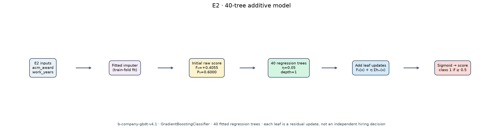
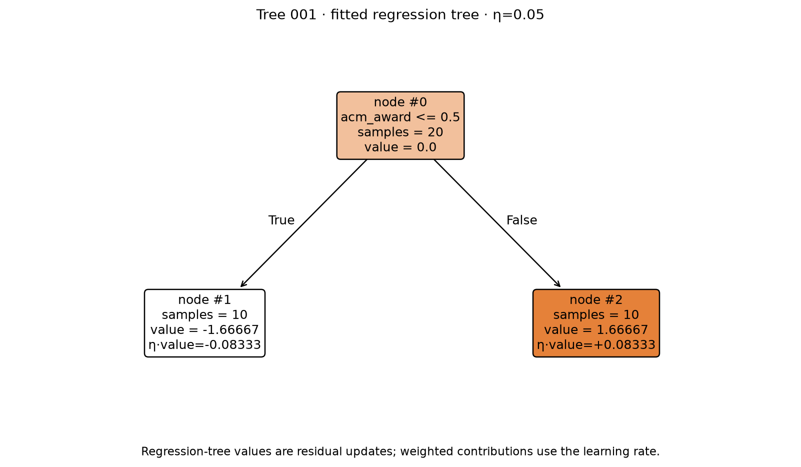

# B 企业简历筛选：GBDT 机器学习实验

[](https://github.com/lloyd-c137/GBDT/actions/workflows/ci.yml)

本项目从 20 份带 A/B/C 评级的 B 企业模拟简历训练 GBDT，并对 260 份无评级的 P 市场模拟简历执行预测。B 与 P 使用独立数据集和原始 INT 编号。数据只用于历史评级模式学习实验，不构成真实招聘筛选建议。

<!-- AUTO:RESULTS:START -->
## 作业问题：直接答案（由本次正式实验结果生成）

| 作业问题 | 直接答案 | 对应产物 |
|---|---|---|
| 1. 整理简历为结构化数据 | B **20** 份、P **260** 份；B 标签 A/B/C = 4/8/8。两组 ID 独立保存。 | [B CSV](data/processed/b_train.csv) · [P CSV](data/processed/p_predict.csv) · [Schema](data/schema.json) |
| 2. 使用 B 企业标注训练 GBDT | E2：`GradientBoostingClassifier`，特征 `acm_award, work_years`，参数 `{"learning_rate": 0.05, "loss": "log_loss", "max_depth": 1, "min_samples_leaf": 2, "n_estimators": 40, "random_state": 42, "subsample": 1.0}`；LOOCV Accuracy **0.9000**，Balanced Accuracy **0.9167**。 | [训练程序](scripts/train_model.py) · [模型](models/gbdt.joblib) · [混淆矩阵](outputs/confusion_matrix.png) · [树图](outputs/figures/gbdt_ensemble_overview.png) |
| 3. 对 P 市场 260 份简历预测 | 正类 **139** 份、负类 **121** 份；固定阈值 0.5。分数未经校准，不是录用概率。 | [完整预测](outputs/p_predictions.csv) · [正类名单](outputs/p_positive_candidates.csv) · [独立预测程序](scripts/predict_market.py) |

**结构化 CSV 的真实行样例**（仅展示非姓名、年龄、薪资字段）：

| 数据集 | ID | 工作年限 | ACM 状态 | ACM 获奖 | 目标岗位 | 技能 | 源文件 |
|---|---:|---:|---|---:|---|---|---|
| B | 1 | 7 | silver | 1 | 前端开发工程师 | Java、Spring Boot、MySQL | b企业/简历_001.md |
| B | 2 | 1 | participated_no_award | 0 | 测试开发工程师 | Python、PyTorch、机器学习 | b企业/简历_002.md |
| P | 1 | 2 | not_participated | 0 | 测试开发工程师 | TypeScript、React、前端工程化 | p市场/简历_001.md |
| P | 2 | 6 | bronze | 1 | 运维开发工程师 | Python、PyTorch、机器学习 | p市场/简历_002.md |

**B 标签 LOOCV 对照**（探索性验证，不是独立测试集）：

| 实验 | 特征 | Accuracy | Balanced Accuracy | 错误 ID |
|---|---|---:|---:|---|
| E0 | none (constant Dummy) | 0.6000 | 0.5000 | 2; 4; 5; 9; 10; 11; 13; 18 |
| E1 | acm_award | 0.9000 | 0.9167 | 14; 20 |
| E2 | acm_award;work_years | 0.9000 | 0.9167 | 14; 20 |
| E3 | work_years | 0.8000 | 0.7917 | 9; 10; 16; 20 |

E1 是 ACM 单特征浅层决策树；E2 是 ACM + 工作年限 GBDT。两者算法和特征集合都不同，不能用 E1/E2 单独估计工作年限的增量效果。E2/E3 使用同一 GBDT 配置，可作为当前 20 条标注上的探索性 ACM 特征消融；不代表因果关系或确定招聘规则。

P 预测正类的**全部原始编号**（与 B 编号空间分开）：

```text
2, 5, 6, 7, 8, 9, 12, 17, 18, 20, 22, 26, 27, 28, 29, 30, 32, 33, 34, 38
39, 41, 44, 45, 48, 50, 52, 53, 56, 57, 58, 59, 61, 62, 63, 65, 67, 69, 72, 73
75, 76, 77, 78, 79, 80, 81, 83, 84, 85, 86, 87, 88, 90, 95, 96, 97, 98, 100, 101
103, 108, 112, 113, 115, 118, 123, 125, 129, 130, 132, 133, 134, 136, 137, 138, 140, 141, 142, 144
146, 150, 152, 153, 155, 156, 157, 158, 161, 163, 165, 168, 171, 173, 174, 176, 178, 180, 183, 185
187, 188, 189, 190, 192, 194, 195, 196, 197, 198, 203, 204, 209, 212, 213, 218, 221, 222, 223, 224
225, 227, 228, 232, 233, 238, 239, 241, 242, 246, 247, 249, 250, 251, 254, 257, 258, 259, 260
```

代表性 P 结果（按原始 ID 顺序；同分保持并列）：

| P ID | 未校准分数 | 预测类别 | 20 轮扰动正类次数 | 人工复核标记 |
|---:|---:|---:|---:|---:|
| 1 | 0.325353 | 0 | 0 / 20 | 0 |
| 2 | 0.929761 | 1 | 20 / 20 | 0 |
| 3 | 0.325353 | 0 | 0 / 20 | 0 |
| 4 | 0.198877 | 0 | 0 / 20 | 0 |
| 5 | 0.929761 | 1 | 20 / 20 | 0 |

本次正式运行：`20261118T164745-4ec59c25`；输入 ZIP 哈希、模型版本和运行环境见 [实验清单](outputs/experiment_manifest.json)。
原文未提供当前月薪的记录按缺失保留（B/P 合计 0 条），未推断或补造薪资值。
<!-- AUTO:RESULTS:END -->

## 目录

- [问题 1：简历结构化](#问题-1简历结构化)
- [问题 2：GBDT 训练与验证](#问题-2gbdt-训练与验证)
- [问题 3：P 市场预测](#问题-3p-市场预测)
- [GBDT 树结构图](#gbdt-树结构图)
- [复现与独立操作](#复现与独立操作)
- [交付文件](#交付文件)
- [限制与伦理边界](#限制与伦理边界)

## 问题 1：简历结构化

原始输入为 `data/raw/b企业.zip` 和 `data/raw/p市场.zip`。数据由提问者确认是模拟简历并获准公开。解析器不读取 G 企业数据，ZIP 只读不改。

两组 CSV 分开保存；ID 仅在各自数据集内唯一。字段包括姓名、年龄原文及数值、当前月薪原文、参加工作时间、工作年限原文及数值、ACM 状态与获奖标记、目标岗位、技能、工作内容、团队协作、职业方向、项目背景、项目职责、GitHub、学校、源文件路径和源 Markdown SHA-256。B 额外保留 A/B/C 原始等级及二分类标签；P 不含企业评级。

个人信息与薪资字段仅作为模拟数据结构化作业产物，不进入模型。主模型输入由白名单固定为 `acm_award` 和 `work_years`。字段、类型、来源、敏感分类和模型用途见 [data/schema.json](data/schema.json)。

解析保留多行文本、Markdown 表格、引用、列表、同行分号字段以及 C#、C++ 等术语。ACM 的获奖、未获奖、未参赛、未见获奖记录分别保留；未见记录不会被解释成确定从未获奖。缺少薪资的记录保持为空，不推断或补造。

上方自动生成区展示从正式 B/P CSV 读取的真实示例行，并省略姓名、年龄、薪资等个人字段；完整记录仍保存在经授权发布的结构化 CSV 中。

- [B 企业 20 份结构化 CSV](data/processed/b_train.csv)
- [P 市场 260 份结构化 CSV](data/processed/p_predict.csv)
- [Schema](data/schema.json)
- [数据质量审计](data/processed/data_quality.json)

`data_quality.json` 记录 ZIP 哈希、编号完整性、缺失字段、解析异常、标签/ACM 分布、类型和重复信息。每条结构化记录通过 `source_file` 和 `source_sha256` 回溯原始 Markdown。

## 问题 2：GBDT 训练与验证

### 标签、特征与模型

二分类目标沿用作业假设：A/B 级为 `label_binary=1`，C 级为 `0`；`label_grade` 原文另行保留。正式 E2 只输入 `acm_award` 与 `work_years`。姓名、年龄、薪资、学校、文本和其他原始字段均被模型特征白名单排除。

固定参数如下，不做参数搜索：

| 参数 | 值 |
|---|---:|
| `loss` | `log_loss` |
| `n_estimators` | 40 |
| `learning_rate` | 0.05 |
| `max_depth` | 1 |
| `min_samples_leaf` | 2 |
| `subsample` | 1.0 |
| `random_state` | 42 |
| 分类阈值 | 0.5 |

输入缺失值处理位于 scikit-learn `Pipeline` 中，每个 LOOCV 折只使用当折 19 条训练样本拟合填补器。P 数据不参与拟合、调参或阈值选择。

### 对照实验与验证

| 实验 | 算法 | 输入 |
|---|---|---|
| E0 | 多数类 `DummyClassifier` | 无有效预测特征 |
| E1 | 深度 1 决策树 | `acm_award` |
| E2 | 固定参数 GBDT | `acm_award` + `work_years` |
| E3 | 固定参数 GBDT | `work_years` |

用 B 的 20 条标注做 Leave-One-Out Cross-Validation。指标和错误 ID 由正式实验产物生成于上方结果区；每份验证简历对应一条记录，混淆矩阵如下：


E1/E2 是两套完整配置的比较：算法和特征集合都变化，不能从该对照中单独推断工作年限的边际作用。E2/E3 使用相同 GBDT 配置，区别是是否包含 ACM，可作为当前样本上的探索性特征消融；这种小样本关联不等于因果或招聘规则。

- [训练入口](scripts/train_model.py)
- [训练与 LOOCV 实验实现](src/train.py) · [验证实现](src/evaluate.py)
- [已拟合 E2 Pipeline 模型](models/gbdt.joblib)
- [实验参数、版本与输入哈希](outputs/experiment_manifest.json)
- [特征重要性与真实分裂节点](outputs/feature_analysis.md)
- [E0–E3 指标](outputs/model_comparison.csv) · [逐样本验证结果](outputs/loocv_predictions.csv)

## 问题 3：P 市场预测

独立预测程序加载已保存的模型文件，按固定 0.5 阈值输出全部 260 条预测以及预测正类子集。上方生成区域列出本次正类的所有 P 原始编号；完整分数、标签、来源与哈希在 [完整预测 CSV](outputs/p_predictions.csv)，正类表在 [候选 CSV](outputs/p_positive_candidates.csv)。

上方自动生成区已经列出本次运行按原始 ID 排序的前 5 条真实预测样例，并展示未校准分数、预测类别、扰动预测次数和复核标记。

分数是固定训练模型的未校准输出，不是真实录用概率。完整稳定性诊断及 20 次扰动分数分别见 [stability_analysis.csv](outputs/stability_analysis.csv) 和 [stability_perturbation_scores.csv](outputs/stability_perturbation_scores.csv)。数值范围外与未见精确特征组合是不同的覆盖信息；后者不是 OOD 检测，也不会单独触发复核。

- [独立预测入口](scripts/predict_market.py)
- [完整 P 市场预测](outputs/p_predictions.csv)
- [预测正类编号与结果](outputs/p_positive_candidates.csv)

## GBDT 树结构图

E2 是 40 棵深度不超过 1 的回归弱学习树组成的加法模型。每棵树给当前 raw score 添加一个经 learning rate 缩放的叶节点更新；单棵树叶节点不是单独的正负类判断。二分类输出经过 logistic 转换成为模型分数，再与 0.5 阈值比较。

### 整体模型



### 一棵实际训练树



树分裂特征、阈值、子节点、样本数、叶节点原始输出与 learning-rate 加权值全部来自已保存模型：
[全 40 棵树的结构 CSV](outputs/gbdt_tree_structure.csv)。

### 全部 40 棵树图集

每页展示 8 棵实际拟合树，共 5 页：

1. [Tree 001–008](outputs/figures/gbdt_trees_page_01.svg)
2. [Tree 009–016](outputs/figures/gbdt_trees_page_02.svg)
3. [Tree 017–024](outputs/figures/gbdt_trees_page_03.svg)
4. [Tree 025–032](outputs/figures/gbdt_trees_page_04.svg)
5. [Tree 033–040](outputs/figures/gbdt_trees_page_05.svg)

代表树：[001](outputs/figures/gbdt_tree_001.svg) · [022](outputs/figures/gbdt_tree_022.svg) · [040](outputs/figures/gbdt_tree_040.svg)。由 [可视化程序](scripts/visualize_gbdt.py) 从 `gbdt.joblib` 可重复生成。

## 复现与独立操作

Python 3.11：

```bash
python -m venv .venv
. .venv/bin/activate
python -m pip install -r requirements.txt
python run_pipeline.py
python -m pytest -q
```

完整 Pipeline 从原始 ZIP 解析、检查、生成结构化 CSV、E0–E3 LOOCV、稳定性评估、保存最终 E2 模型、预测 P、导出树图与报告。它先写入独立 Run ID 目录，验证所有输出后才发布。

独立训练（只读取 B CSV）：

```bash
python scripts/train_model.py --data data/processed/b_train.csv --output /tmp/gbdt-standalone.joblib
```

独立预测（只加载模型和 P CSV，不重训）：

```bash
python scripts/predict_market.py \
  --model /tmp/gbdt-standalone.joblib \
  --manifest /tmp/gbdt-standalone.manifest.json \
  --data data/processed/p_predict.csv \
  --output /tmp/p_predictions-standalone.csv
```

重新生成 40 棵树的全部图：

```bash
python scripts/visualize_gbdt.py --model models/gbdt.joblib --manifest outputs/experiment_manifest.json
```

更新或核验 README 中的统计区：

```bash
python scripts/update_readme.py
python scripts/update_readme.py --check
```

更新程序仅读取已验证的已提交实验产物，不会使用 CI 临时合成结果更新正式答案区。

完整讲解见 [演示脚本](docs/DEMO.md) 和 [技术实现说明](docs/IMPLEMENTATION.md)。

## 交付文件

| 内容 | 路径 |
|---|---|
| 原始 B/P ZIP | `data/raw/` |
| 独立结构化数据 | `data/processed/b_train.csv`、`data/processed/p_predict.csv` |
| 数据 Schema 与审计 | `data/schema.json`、`data/processed/data_quality.json` |
| 训练、验证、预测、解释代码 | `src/`、`scripts/` |
| 拟合模型 | `models/gbdt.joblib` |
| 指标、逐样本验证、预测、稳定性、树结构 | `outputs/*.csv` |
| 混淆矩阵、40 棵树图集 | `outputs/confusion_matrix.png`、`outputs/figures/` |
| 实验清单和最终报告 | `outputs/experiment_manifest.json`、`outputs/final_report.md` |
| 演示与实现文档 | `docs/DEMO.md`、`docs/IMPLEMENTATION.md` |

## 限制与伦理边界

- B 训练样本只有 20 条，LOOCV 是探索性估计，没有独立测试集。
- E1 与 E2 的比较同时改变算法和输入，不能用它估计工作年限的独立增益。
- E2/E3 只是在当前小样本上的 ACM 特征消融，不代表因果效果或真实企业规则。
- 当前模型由少量结构化特征学习历史标签模式，不代表岗位胜任力。
- 分数未经概率校准，不应直接用于真实招聘、淘汰或自动决策。
- CI 使用合成夹具、稀疏检出，不上传候选人内容或工作流产物。
